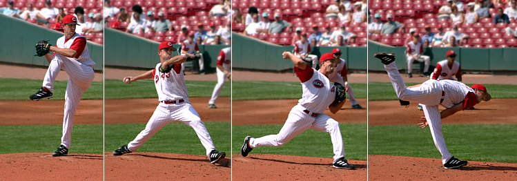
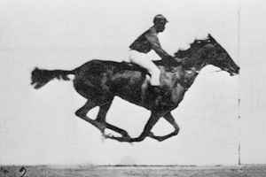

# 12 Principles of Animation

The **12 Basic Principles of Animation** were developed by Disney and
introduced by Ollie Johnston and Frank Thomas in their 1981 book
*The Illusion of Life: Disney Animation*. They based their book on the work
of Disney's leading animators of the 1930s, who sought to produce more
realistic animation. The primary purpose of the principles was to create the
illusion that animated characters obeyed the basic laws of physics — but they
also addressed more abstract issues, such as emotional timing and
character appeal.

The book and several of its principles were adopted by some traditional
animation studios and have been cited by some as the "Bible of
animation". In 1999, the book was voted the number one "best animation book
of all time" in an online poll by *Animation World Network*.

> **How to use this skill:** open any principle and go from theory to
> practice — see the definition, purpose, and an example visual. Use
> `templates/study-log.md` to keep your own animation notebook, or the
> `references/*.md` files to go deeper into a specific topic.

---

## The 12 Principles

1. [Squash and Stretch](#1-squash-and-stretch)
2. [Anticipation](#2-anticipation)
3. [Staging](#3-staging)
4. [Straight Ahead Action and Pose to Pose](#4-straight-ahead-action-and-pose-to-pose)
5. [Follow Through and Overlapping Action](#5-follow-through-and-overlapping-action)
6. [Slow In and Slow Out](#6-slow-in-and-slow-out)
7. [Arcs](#7-arcs)
8. [Secondary Action](#8-secondary-action)
9. [Timing](#9-timing)
10. [Exaggeration](#10-exaggeration)
11. [Solid Drawing](#11-solid-drawing)
12. [Appeal](#12-appeal)

---

## 1. Squash and Stretch

The principle of **squash and stretch** shows a ball falling with rigid,
non-dynamic movement (example A). In example B the ball is "squashed" by the
impact and "stretched" during the fall and bounce. The movement also
accelerates during the fall and decelerates toward the apex — the principle
of "slow in and slow out".

**Purpose:** to give drawn objects a sense of weight and flexibility. It can
be applied to simple objects, like a bouncing ball, or to more complex
constructions, like human facial musculature. Taken to an extreme, a
stretched or squashed figure can be comical.

In realistic animation, the most important aspect is that the object's
**volume does not change** when squashed or stretched: if a ball's length is
stretched vertically, its width (and depth, in 3D) must contract
correspondingly horizontally.

---

## 2. Anticipation

Anticipation prepares the audience for an action and makes it feel more
realistic. A dancer jumping off the ground must first bend their knees; a
golfer must do a backswing, moving the club in the opposite direction before
executing the movement.

The technique also applies to less physical actions: a character looking
out of the frame anticipates someone's arrival; attention focusing on an
object a character is about to grab.

*Anticipation: a baseball player winding up a pitch, moving the arm back
before throwing.*

---

## 3. Staging

The principle of staging is similar to staging in theater. Its purpose is to
direct the audience's attention and make clear what is most important in the
scene. Johnston and Thomas defined it as "the presentation of any idea so it
is complete and undeniably clear", whether that idea is an action, a
personality, an expression, or a mood.

It can be achieved through character placement in the frame, use of light
and shadow, or camera angle and position. The essence is to keep the focus
on what matters and avoid unnecessary detail.

---

## 4. Straight Ahead Action and Pose to Pose

Two different approaches in the animation process:

- **Straight Ahead:** scenes are animated frame by frame, from start to
  finish. It creates a more fluid and dynamic movement illusion and is best
  for realistic action sequences. However, it is difficult to maintain
  proportions and create exact, convincing poses along the way.
- **Pose to Pose:** a few key frames are drawn first, then the intervals are
  filled in. It works better for dramatic or emotional scenes, where
  composition and relationship to the surroundings matter. Combining both
  techniques is very common.

### In computer animation

Computer animation removes the proportion problems of the "straight ahead"
style, but "pose to pose" is still used because of its compositional
advantages. Computers make this method easier and can automatically fill
missing intermediate sequences.

---

## 5. Follow Through and Overlapping Action

"Follow through and overlapping action" is a general designation for two
closely related techniques that reproduce movement more realistically,
giving the impression that characters follow the laws of physics, including
the principle of inertia.

- **Follow through:** parts loosely attached to a body continue to move
  after the character stops, beyond the point where the character stopped,
  then are "pulled back" toward the center of mass or undergo damping
  oscillation.
- **Overlapping action:** body parts move at different speeds (an arm moves
  in a different time from the head).

A third related technique is **follow through**, in which the character
begins to move and parts of it take a few frames to catch up. This can be
inanimate objects like clothing or a car antenna, or body parts like arms
and hair. In the human body, the torso is the core, with arms, legs,
head, and hair as appendages that follow the torso's movement. Body parts
with a lot of tissue (wide stomachs and breasts, or dog floofs) are more
prone to independent movement than bony parts.

Excessive use of the technique leads to a comical effect; more realistic
animations must time the actions exactly.

> **Moving hold:** animation between two very similar positions — characters
> sitting still or barely moving — maintains some kind of slight movement,
> such as breathing or a slight position change. This prevents the drawing
> from becoming "dead".

*Follow through and overlapping action: the tail and mane of the running
horse gallop along with the body. Photo by Eadweard Muybridge.*

---

## 6. Slow In and Slow Out

Objects in real life (human body, animals, vehicles) need time to
accelerate and decelerate. For this reason, more frames are drawn at the
**start** and **end** of an action, creating the effect of acceleration and
deceleration. This concept emphasizes the extreme poses.

Conversely, fewer drawings are made in the **middle** of the animation to
emphasize the quick action. The principle applies to characters moving
between two extreme poses (sitting and standing up) and to inanimate beings
that move, like a bouncing ball.

---

## 7. Arcs

Most natural actions follow the trajectory of an arc, and animation should
adopt this principle for greater realism. It can be applied to a limb
moving through the rotation of a joint, or to a thrown object along a
parabolic trajectory. The exception is mechanical movement, which typically
moves in a straight line.

As an object's speed or momentum increases, arcs tend to flatten and
lengthen. In baseball, a fast ball tends to move in a straight line; an
ice skater at maximum speed cannot turn as tightly as a slower skater and
needs more space to complete a turn.

An object that moves outside its natural arc without apparent reason looks
inconsistent rather than fluid. When animating a pointing finger, the tip
should follow a logical arc between two extreme poses. Traditional
animators lightly draw the arc on paper as a reference, to be erased later.

---

## 8. Secondary Action

Adding secondary actions to the main action gives the scene more life and
can help support the main action. A walking person can, at the same time,
swing their arms, keep them in their pockets, talk, whistle, or express
emotions through facial expressions.

The important thing about secondary actions is that they must emphasize the
main action, not distract from it. If that is the case, it is better to
leave them out. For example, during a dramatic movement, facial expressions
are usually unnoticed; in these cases, it is better to include them at the
beginning and end of the movement, rather than during it.

---

## 9. Timing

Timing refers to the number of drawings or frames for a given action,
representing the speed of the action in the film.

At a purely physical level, correct timing makes the object seem to obey the
laws of physics: weight determines how an object reacts to an impulse — a
light object reacts faster than a heavy one. Timing is decisive for
establishing the mood, emotion, and reaction of the character, and can also
be a device to communicate aspects of the character's personality.

---

## 10. Exaggeration

Animated movements that try to perfectly imitate reality can appear stiff
and awkward; exaggeration is particularly useful.

The level of exaggeration depends on whether you seek realism or a particular
style (caricature, or the style of a specific artist). The classic
Disney definition was to remain faithful to reality, presenting it in a more
evident and extreme way. Other forms of exaggeration can involve the
supernatural or surreal, alterations in a character's physical
characteristics, or story elements themselves.

It is important to use a certain degree of restraint: if a scene contains
many elements, there should be balance in how they are exaggerated in
relation to one another, to avoid confusing or intimidating the viewer.

---

## 11. Solid Drawing

The principle of "solid drawing" means taking into account forms in
three-dimensional space, giving them volume and weight. The animator needs
to be a talented artist and understand the basics of three-dimensional
shapes, anatomy, weight, balance, light, and shadow.

For the classic animator, this involved attending art classes and doing
lifedrawing. Johnston and Thomas warned about the creation of "twins":
characters whose left and right sides are mirrored and seem lifeless.

### In computer animation

Despite digital animators drawing less thanks to computer convenience, they
still benefit greatly from understanding the basic principles and their
additions to computer animation.

---

## 12. Appeal

Appeal in an animated character corresponds to what would be called charisma
in an actor. A character with appeal is not necessarily likable: villains
and monsters can have it too. The important thing is that the viewer feels
the character is real and interesting.

There are many tricks to make a character connect better with the audience.
For friendly characters, a symmetrical face or "baby-like" face tends to be
effective. A complicated or hard-to-read face lacks appeal or "attraction" in
the composition of the pose or the character's drawing.

---

## References

1. Johnston, Ollie; Thomas, Frank. *The Illusion of Life: Disney Animation*
   (1981).
2. Wikipedia —
   [12 basic principles of animation](https://pt.wikipedia.org/wiki/12_princ%C3%ADpios_b%C3%A1sicos_de_anima%C3%A7%C3%A3o).
3. "Walt Disney's Nine Old Men & The Art Of Animation", *Animation World
   Network*.
4. Lasseter, John. "Principles of traditional animation applied to 3D
   computer animation" (SIGGRAPH, 1987).

Detailed principles with original citations and sources are on the
Wikipedia page.
